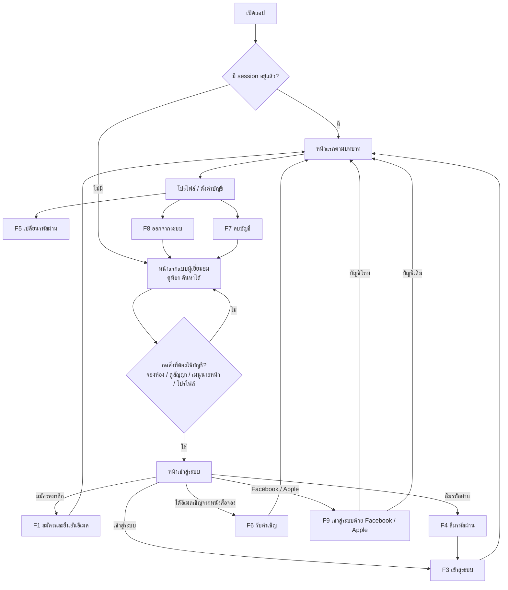
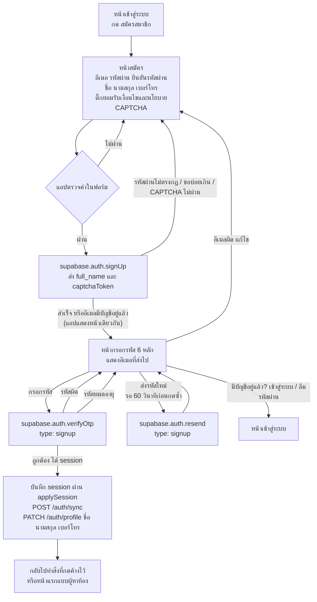
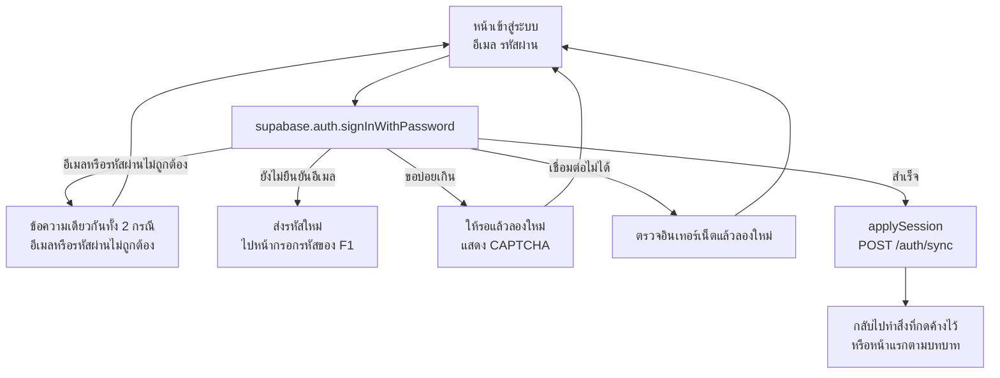
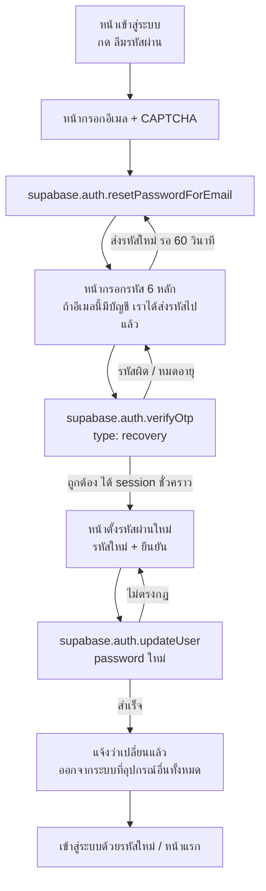
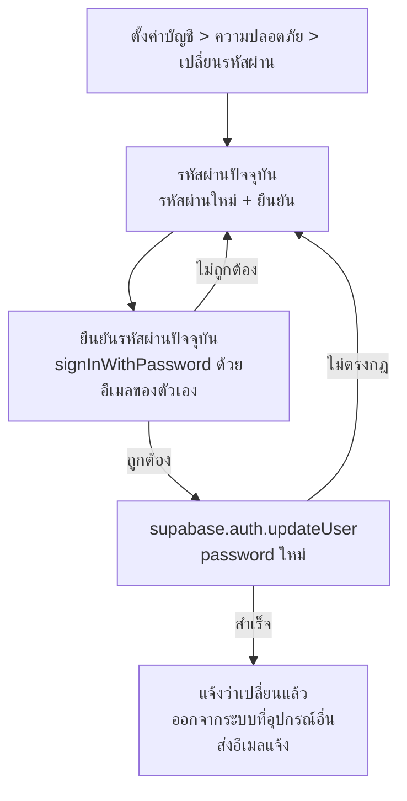
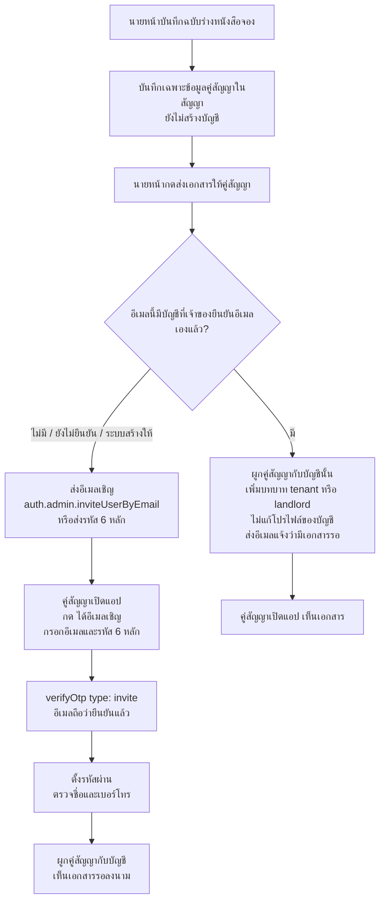
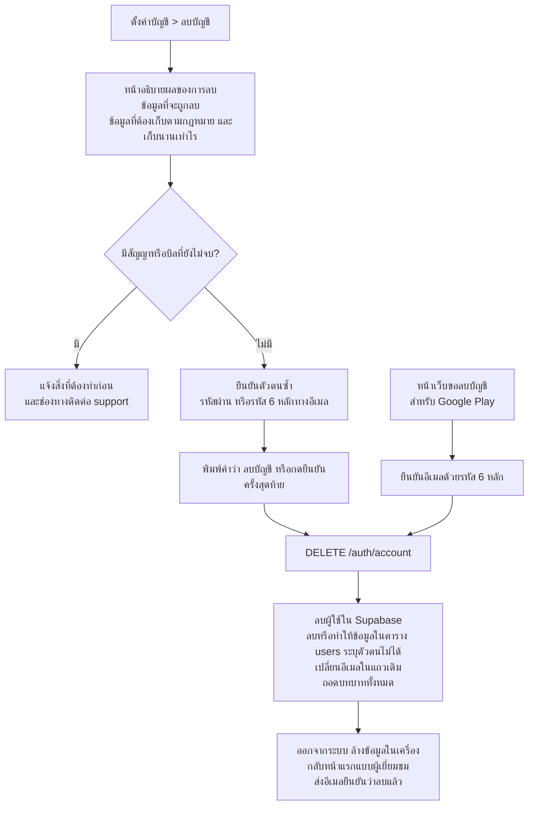
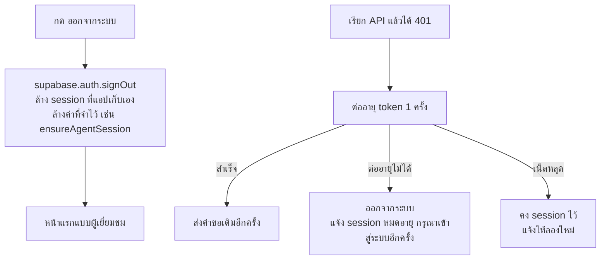
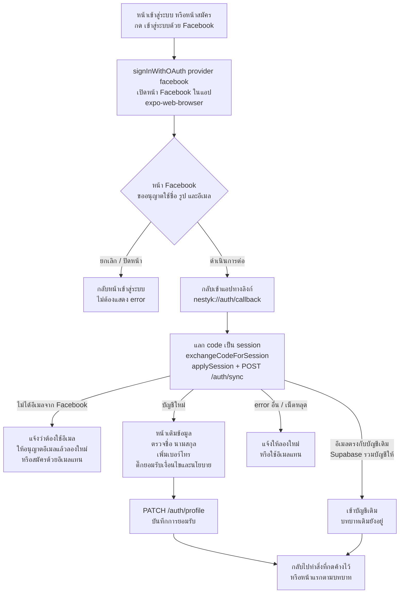
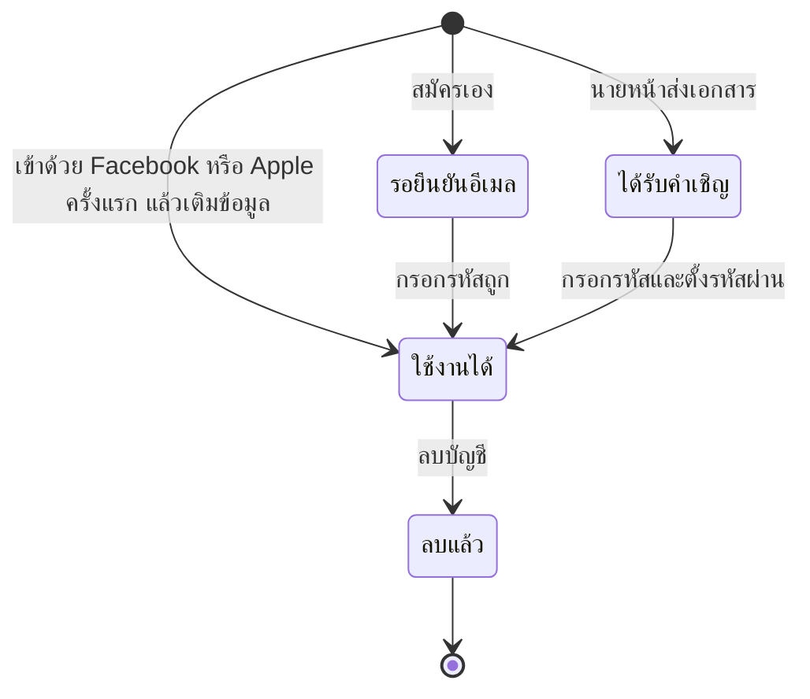

# ออกแบบ flow บัญชีผู้ใช้: สมัครสมาชิก เข้าสู่ระบบ และลบบัญชี — NESTYK

> **สำหรับ:** ทีม dev, PM และคนที่ต้องตัดสินใจเรื่องการขึ้น store
> **จัดทำโดย:** Aof (QA) — 22 ต.ค. 2026
> **อ้างอิงโค้ด:** commit `4833ace` บน branch `qa/e2e` (merge `develop` ล่าสุดแล้ว)
> **วิธีได้ข้อมูล:** ส่วนที่บอกสภาพโค้ดมาจากการอ่านโค้ด ยังไม่ได้รันจริง ส่วนที่เป็น flow ใหม่เป็นข้อเสนอ ซึ่งสรุปเลือกแล้วเมื่อ 22 ต.ค. 2026 (ข้อ 11)
> **เอกสารคู่กัน:** `nestyk-signup-dev-guide.md` (รายการงานและช่องโหว่ที่ต้องแก้) เอกสารนี้ตอบคำถามว่า "ผู้ใช้เดินทางผ่านหน้าจอไหน ระบบทำอะไร และทำไมถึงปลอดภัยและผ่าน store"
>
> **ขอบเขต:** เฉพาะการเข้าถึงบัญชี คือ สมัคร ยืนยันอีเมล เข้าสู่ระบบ (อีเมล, Facebook, Apple) ลืมและเปลี่ยนรหัสผ่าน ออกจากระบบ และลบบัญชี **ไม่รวมการได้บทบาท** (ผู้เช่า เจ้าของห้อง นายหน้า admin) ซึ่งอยู่ในแผน Phase 1 (`nestyk-phase1-listing-room-plan.md`) หลังสมัคร ผู้ใช้ทุกคนเริ่มเป็นผู้หาห้อง (`guest`) (ปรับขอบเขต 29 ต.ค. 2026)
>
> **อ่านแผนภาพอย่างไร:** แผนภาพเขียนด้วย Mermaid เปิดใน GitHub, GitLab, VS Code (ติดตั้งส่วนเสริม Mermaid) หรือวางที่ mermaid.live จะเห็นเป็นภาพ

---

## สารบัญ

1. [สรุปสำหรับคนตัดสินใจ](#1-สรุปสำหรับคนตัดสินใจ)
2. [หลักการออกแบบ](#2-หลักการออกแบบ)
3. [ภาพรวมเส้นทางของผู้ใช้](#3-ภาพรวมเส้นทางของผู้ใช้)
4. [flow ย่อย](#4-flow-ย่อย)
   - [F1 สมัครสมาชิกและยืนยันอีเมล](#f1-สมัครสมาชิกและยืนยันอีเมล)
   - [F2 สิทธิ์หลังเข้าสู่ระบบ](#f2-สิทธิ์หลังเข้าสู่ระบบ)
   - [F3 เข้าสู่ระบบ](#f3-เข้าสู่ระบบ)
   - [F4 ลืมรหัสผ่าน](#f4-ลืมรหัสผ่าน)
   - [F5 เปลี่ยนรหัสผ่านในหน้าตั้งค่า](#f5-เปลี่ยนรหัสผ่านในหน้าตั้งค่า)
   - [F6 บัญชีของคู่สัญญาจากหนังสือจอง](#f6-บัญชีของคู่สัญญาจากหนังสือจอง)
   - [F7 ลบบัญชี](#f7-ลบบัญชี)
   - [F8 ออกจากระบบ และ session หมดอายุ](#f8-ออกจากระบบ-และ-session-หมดอายุ)
   - [F9 เข้าสู่ระบบด้วย Facebook (และ Apple บน iOS)](#f9-เข้าสู่ระบบด้วย-facebook-และ-apple-บน-ios)
5. [สถานะของบัญชี](#5-สถานะของบัญชี)
6. [หน้าจอที่ต้องมี](#6-หน้าจอที่ต้องมี)
7. [มาตรการความปลอดภัย](#7-มาตรการความปลอดภัย)
8. [checklist การขึ้น store](#8-checklist-การขึ้น-store)
9. [ข้อความที่ผู้ใช้เห็น](#9-ข้อความที่ผู้ใช้เห็น)
10. [ขอบเขตที่ไม่ทำในรอบนี้](#10-ขอบเขตที่ไม่ทำในรอบนี้)
11. [ข้อสรุปที่ใช้](#11-ข้อสรุปที่ใช้)
12. [แหล่งอ้างอิง](#12-แหล่งอ้างอิง)

---

## 1. สรุปสำหรับคนตัดสินใจ

**สิ่งที่เสนอ**
- ผู้ใช้ยังเข้าดูห้องได้โดยไม่ต้องมีบัญชีเหมือนเดิม ระบบจะขอให้สมัครหรือเข้าสู่ระบบเฉพาะตอนที่ต้องใช้บัญชีจริง เช่น จองห้อง ดูสัญญา หรือเปิดเมนูนายหน้า
- สมัครด้วยอีเมลและรหัสผ่าน แล้ว**ยืนยันอีเมลด้วยรหัสตัวเลข 6 หลักที่ส่งไปทางอีเมล** (แนะนำ) แทนการกดลิงก์
- สมัครแล้วผู้ใช้เริ่มเป็นผู้หาห้อง (`guest`) ไม่มีหน้าเลือกบทบาท และแอปขอสิทธิ์ให้ตัวเองไม่ได้ การได้บทบาทอื่นอยู่ในแผน Phase 1
- ผู้เช่าและผู้ให้เช่าที่นายหน้าใส่ไว้ในหนังสือจองจะได้**อีเมลเชิญ** ให้ตั้งรหัสผ่านเอง แทนการใช้เบอร์โทรเป็นรหัสผ่าน
- มีปุ่มลบบัญชีในแอป และมีหน้าเว็บสำหรับขอลบบัญชี ตามที่ Apple และ Google กำหนด

**ทำไมยืนยันอีเมลด้วยรหัส 6 หลัก แทนการกดลิงก์**

| | A. รหัส 6 หลักในอีเมล (แนะนำ) | B. ลิงก์ในอีเมล |
|---|---|---|
| ผู้ใช้ทำอะไร | เปิดอีเมล จำรหัส แล้วกลับมาพิมพ์ในแอป | เปิดอีเมลบนมือถือเครื่องเดียวกับที่ติดตั้งแอป แล้วกดลิงก์ |
| เปิดอีเมลบนคอมพิวเตอร์ได้ไหม | ได้ | ไม่ได้ ลิงก์ `nestyk://` เปิดบนคอมพิวเตอร์ไม่ได้ |
| งานของ dev | หน้ากรอกรหัส 1 หน้า เรียก `verifyOtp` ไม่ต้องตั้ง deep link | ตั้ง Redirect URL, ตัวรับลิงก์ และควรใช้ Universal Links/App Links ซึ่งต้องตั้งค่าโดเมน |
| ความปลอดภัย | ไม่มีข้อมูลลับอยู่ในลิงก์ | ถ้าใช้ลิงก์แบบ `nestyk://` แอปอื่นที่จดชื่อเดียวกันอาจรับลิงก์ไปได้ Supabase จึงแนะนำ Universal Links |
| ชนกับตัวรับลิงก์เดิมไหม | ไม่ชน | ตัวรับลิงก์เดิมสลับบทบาทจากคำในลิงก์ (`app/index.tsx` บรรทัด 248-280) ต้องระวังไม่ให้ชนกัน |
| ใช้กับลืมรหัสผ่านและอีเมลเชิญได้ไหม | ได้ ใช้หน้ากรอกรหัสเดียวกัน | ได้ แต่ต้องรับลิงก์ทุกแบบ |

**สิ่งที่ต้องเสร็จก่อนเปิดให้สมัคร** (รายละเอียดอยู่ในคู่มือ dev)
1. ปิดค่าสำหรับนักพัฒนาบนระบบจริง (`ALLOW_DEV_AUTH`, `ALLOW_DEV_ROLE_GRANT` และค่าฝั่งแอป)
2. เปิดการยืนยันอีเมลใน Supabase ที่ใช้งานจริง
3. แก้การสร้างบัญชีจากหนังสือจอง ตาม F6
4. เตรียมนโยบายความเป็นส่วนตัว เงื่อนไขการใช้งาน และหน้าเว็บขอลบบัญชี

---

## 2. หลักการออกแบบ

| # | หลักการ | ใช้ใน flow อย่างไร | ที่มา |
|---|---|---|---|
| P1 | ใช้งานส่วนที่ไม่ต้องมีบัญชีได้โดยไม่ต้อง login | ดูห้องและค้นหาได้ในโหมดผู้เยี่ยมชม (guest) ซึ่งแอปมีอยู่แล้ว ขอ login เฉพาะเมื่อกดสิ่งที่ต้องใช้บัญชี | Apple 5.1.1(v) |
| P2 | ถามเฉพาะข้อมูลที่ขั้นถัดไปต้องใช้ และถามครั้งเดียว | ตอนสมัครถามแค่ อีเมล รหัสผ่าน ชื่อ นามสกุล เบอร์โทร ส่วนเลขบัตรประชาชนถามตอนทำสัญญา | Apple 5.1.1(iii), PDPA |
| P3 | ทุกหน้าต้องมีทางไปขั้นถัดไป | หน้ากรอกรหัสมีปุ่มส่งรหัสใหม่ เปลี่ยนอีเมล และกลับไปเข้าสู่ระบบ หน้าข้อผิดพลาดบอกเสมอว่าต้องทำอะไรต่อ | หลักออกแบบ flow ของทีม |
| P4 | การกระทำสำคัญต้องยืนยันก่อน และระบบต้องรู้ผล | ลบบัญชีต้องยืนยันตัวตนซ้ำ และแจ้งผลทางอีเมล | หลักออกแบบ flow ของทีม |
| P5 | สิทธิ์ตัดสินที่ API เท่านั้น | แอปซ่อนหรือแสดงเมนูตามบทบาทได้ แต่ API ต้องตรวจบทบาทเองทุกครั้ง แอปขอบทบาทให้ตัวเองไม่ได้ | ความปลอดภัย |
| P6 | ไม่บอกคนนอกว่าอีเมลไหนมีบัญชี | ตอนสมัครด้วยอีเมลที่มีบัญชีแล้ว และตอนขอรีเซ็ตรหัสผ่าน แอปแสดงหน้าเดียวกับกรณีปกติ | ความปลอดภัย, กันคนเดาว่าใครเป็นลูกค้า |
| P7 | ผูกบัญชีกับข้อมูลในสัญญาได้เฉพาะเมื่อพิสูจน์แล้วว่าเป็นเจ้าของอีเมล | บัญชีที่ยังไม่ยืนยันอีเมลจะไม่เห็นสัญญา | ปิดช่องโหว่ "จองอีเมลไว้ก่อน" ในคู่มือ dev ข้อ 4.2 |
| P8 | ข้อมูลของคู่สัญญาอยู่ในสัญญา ไม่เขียนทับโปรไฟล์ของผู้ใช้ | ชื่อและเลขบัตรที่นายหน้ากรอกเก็บในข้อมูลผู้เช่าหรือสัญญา ส่วนโปรไฟล์ผู้ใช้แก้ได้โดยเจ้าของเท่านั้น | ปิดช่องโหว่ "นายหน้าเขียนทับข้อมูล" ในคู่มือ dev ข้อ 4.2 |

---

## 3. ภาพรวมเส้นทางของผู้ใช้

**จุดที่ต่างจากตอนนี้**
- ตอนนี้แอปพาไปหน้าเข้าสู่ระบบเมื่อเลือกบทบาทที่ต้องใช้บัญชี (`app/index.tsx` บรรทัด 523-526, 555-556) จุดนี้ใช้ต่อได้ เพียงเพิ่มทางไป "สมัครสมาชิก" ให้ใช้ได้จริง
- หลัง login ระบบควรพากลับไปทำสิ่งที่ผู้ใช้กดค้างไว้ เช่น หน้าจองห้องที่เปิดอยู่ ไม่ใช่กลับไปหน้าแรก

---

## 4. flow ย่อย

### F1 สมัครสมาชิกและยืนยันอีเมล

| ขั้น | ผู้ใช้เห็นและทำ | ระบบทำ | หมายเหตุ |
|---|---|---|---|
| 1 | กรอกฟอร์มสมัคร | ตรวจรูปแบบอีเมล ความยาวชื่อ (ไม่เกิน 255 ตัว) เบอร์โทร (ไม่เกิน 50 ตัว) กฎรหัสผ่าน และต้องติ๊กยอมรับ | แสดงกฎรหัสผ่านให้เห็นก่อนพิมพ์ ใช้ `PhoneField` เดิม |
| 2 | กด "สมัคร" | `signUp` ส่ง `options.data.full_name` และ `options.captchaToken` | ปุ่มกดได้ครั้งเดียวระหว่างรอผล |
| 3 | เห็นหน้า "เราส่งรหัส 6 หลักไปที่ x***@mail.com" | — | **ทุกกรณีแสดงหน้านี้** รวมถึงกรณีอีเมลมีบัญชีแล้ว (P6) เอกสาร Supabase บอกว่าเมื่ออีเมลมีบัญชีอยู่แล้ว อาจได้คำตอบที่ซ่อนข้อมูลนี้ไว้ ซึ่งขึ้นกับการตั้งค่า dev ต้องลองบนโปรเจกต์จริงว่าตอบแบบไหน แต่ไม่ว่า Supabase จะตอบแบบไหน แอปก็แสดงหน้านี้ และอีเมลที่มีบัญชีแล้วจะไม่ได้รับรหัส หน้านี้จึงต้องมีทาง "มีบัญชีอยู่แล้ว? เข้าสู่ระบบ / ลืมรหัสผ่าน" |
| 4 | พิมพ์รหัส | `verifyOtp({ email, token, type: 'signup' })` | ข้อความในอีเมลยืนยันต้องใช้ `{{ .Token }}` แทน `{{ .ConfirmationURL }}` รหัสหมดอายุตามค่า `otp_expiry` (ค่าในเครื่องคือ 3600 วินาที) |
| 5 | รอสักครู่ | บันทึก session ผ่าน `applySession` แล้วเรียก `/auth/sync` ตามด้วย `PATCH /auth/profile` | ส่งชื่อและนามสกุลแยกกันอีกครั้ง เพราะ API แยกชื่อเต็มจาก metadata ด้วยช่องว่าง (`auth.guard.ts` บรรทัด 90-92) แล้ว `sync` ใช้ค่านั้นตอนสร้างผู้ใช้ใหม่ ชื่อที่มีช่องว่างจะถูกแยกผิด |
| 6 | กลับไปทำสิ่งที่กดค้างไว้ เช่น นัดดูห้อง หรือไปหน้าแรก | — | ถ้าปิดแอประหว่างขั้น 3-4 เปิดใหม่ให้กลับมาที่หน้ากรอกรหัส หรือเริ่ม login ใหม่ได้ |

**ข้อมูลที่ถาม และเหตุผลที่ต้องถาม** (ใช้กรอกแบบฟอร์มความเป็นส่วนตัวของ store ได้ด้วย)

| ข้อมูล | ใช้ทำอะไร | ทำไมต้องถามตอนสมัคร |
|---|---|---|
| อีเมล | เข้าสู่ระบบ ยืนยันตัวตน ส่งเอกสารสัญญา | ใช้เป็นชื่อบัญชี |
| รหัสผ่าน | เข้าสู่ระบบ | ใช้เป็นชื่อบัญชี |
| ชื่อ นามสกุล | แสดงในแอป ใช้ในสัญญาเช่า | สัญญาเช่าต้องใช้ชื่อเต็ม |
| เบอร์โทร | ให้นายหน้าหรือเจ้าของห้องติดต่อเรื่องนัดดูห้องและสัญญา | กฎ "โปรไฟล์ครบ" ของระบบต้องมี (`auth.service.ts` บรรทัด 144) |
| การยอมรับเงื่อนไขและนโยบาย | หลักฐานว่าผู้ใช้ยินยอม | ต้องเก็บเวลาที่ยอมรับและฉบับของเอกสาร |

**ไม่ถามตอนสมัคร:** เลขบัตรประชาชน พาสปอร์ต สัญชาติ วันเกิด และรูปโปรไฟล์

### F2 สิทธิ์หลังเข้าสู่ระบบ

> การได้บทบาทผู้เช่า เจ้าของห้อง นายหน้า และ admin อยู่นอกขอบเขตของเอกสารนี้ ดูแผน Phase 1 (ข้อ T3 และ A4) หัวข้อนี้เก็บไว้เฉพาะกฎที่เกี่ยวกับการเข้าสู่ระบบ

- หลังสมัครหรือเข้าด้วย Facebook / Apple ครั้งแรก ผู้ใช้ได้บทบาท `guest` อย่างเดียว ซึ่ง `/auth/sync` ทำอยู่แล้ว ไม่มีหน้าเลือกบทบาท
- **ตัดออกจากแอป:** การขอสิทธิ์ admin และ agent ให้ตัวเองอัตโนมัติ (`ensureAdminRole` ใน `AuthContext.tsx`, `ensureAgentSession` ใน `agent-session.ts`)
- **เมนูเลือกบทบาทและลิงก์ `nestyk://agent`, `nestyk://admin`** ต้องเปิดได้เฉพาะเมื่อ `session.roles` มีบทบาทนั้น (ตอนนี้ตรวจแค่ว่า login แล้ว: เมนูอยู่ที่ `app/index.tsx` บรรทัด 522-534 ส่วนลิงก์ตั้งบทบาททันทีที่บรรทัด 260-265 แล้ว effect ที่บรรทัด 555-556 จึงพาไปหน้า login)
- **API ตรวจซ้ำทุกครั้ง** ด้วย `@Roles(...)` บน controller ไม่เชื่อว่าแอปซ่อนเมนูแล้ว
- เมื่อสลับบัญชีบนเครื่องเดียวกัน ต้องไม่ใช้บทบาทของบัญชีก่อนหน้า (F8)

### F3 เข้าสู่ระบบ

- **ตัดออกจากแอปที่ build ไปใช้งานจริง:** การ login ด้วยบัญชี dev เมื่อ Supabase ไม่ผ่าน (`AuthContext.tsx` บรรทัด 132-142, 154-173) และการกรอกอีเมลกับรหัสผ่าน dev ให้เองในหน้า login (`login.tsx` บรรทัด 71-76)
- ถ้าไม่มี session แอปต้องไม่ส่ง dev token ไปแทน (`lib/api.ts`) ให้เรียก API ที่ไม่ต้องใช้บัญชีโดยไม่ส่ง token หรือพาไปหน้าเข้าสู่ระบบ
- รหัสผ่านไม่ตรงกฎใหม่: เอกสาร Supabase บอกว่าผู้ใช้เดิมยัง login ได้แต่จะได้คำเตือน ถ้าได้คำเตือน **แนะนำ** ให้พาไปหน้าตั้งรหัสผ่านใหม่ (F5) หลัง login สำเร็จ ต้องลองจริงก่อนว่า Supabase ส่งคำเตือนมาแบบไหน

### F4 ลืมรหัสผ่าน

- หน้าหลังกรอกอีเมลต้องเหมือนกันไม่ว่าอีเมลนั้นมีบัญชีหรือไม่ (P6) เอกสาร Supabase ระบุว่า `resetPasswordForEmail` ไม่บอกว่ามีบัญชีหรือไม่อยู่แล้ว
- ข้อความในอีเมลรีเซ็ตรหัสผ่านต้องใช้ `{{ .Token }}`
- **แนะนำ:** หลังเปลี่ยนรหัสผ่าน ให้ออกจากระบบที่อุปกรณ์อื่น (`signOut({ scope: 'others' })`) และส่งอีเมลแจ้งว่ามีการเปลี่ยนรหัสผ่าน
- flow นี้ใช้แก้ปัญหาผู้เช่าเดิมที่ได้บัญชีจากหนังสือจองและไม่รู้รหัสผ่านด้วย

### F5 เปลี่ยนรหัสผ่านในหน้าตั้งค่า

> ⚠️ **สภาพตอนนี้:** หน้าเปลี่ยนรหัสผ่าน (`packages/ui/src/shells/MobileChangePasswordBody.tsx` บรรทัด 32-56) ตรวจแค่ว่ากรอกรหัสผ่านปัจจุบัน รหัสใหม่ยาวอย่างน้อย 8 ตัว และยืนยันตรงกัน แล้วขึ้นข้อความ "อัปเดตรหัสผ่านเรียบร้อยแล้ว" **โดยไม่ได้เรียก Supabase หรือ API เลย รหัสผ่านจึงไม่ได้เปลี่ยนจริง** ผู้ใช้จะเข้าใจผิดว่าเปลี่ยนแล้ว และขัดกับ Apple 2.1 ที่ห้ามส่งแอปที่มีส่วนที่ยังทำงานไม่ได้ ต้องทำให้ใช้ได้จริง หรือซ่อนไว้ก่อนส่ง store

- **แนะนำ:** เปิด "Secure password change" ใน Supabase (ค่าในเครื่องตอนนี้ปิดอยู่ `secure_password_change = false`) เพื่อให้ Supabase บังคับยืนยันตัวตนซ้ำเมื่อ login มานานแล้ว
- ข้อความกฎรหัสผ่านเดิม "ตัวอักษรและตัวเลข" (`packages/i18n/src/locales/th.ts` บรรทัด 254) ต้องแก้ให้ตรงกับกฎใหม่ และหน้าจอตรวจตามกฎเดียวกับหน้าสมัคร

### F6 บัญชีของคู่สัญญาจากหนังสือจอง

**ตอนนี้** (`apps/api/src/agent/contracts/party-login.ts`):
- ระบบสร้างบัญชีให้ผู้เช่าและผู้ให้เช่าทันทีที่นายหน้า**บันทึกฉบับร่าง**หนังสือจอง และใช้เบอร์โทรเป็นรหัสผ่าน
- บัญชีที่ระบบสร้างถูกตั้งเป็น**ยืนยันอีเมลแล้ว**ตั้งแต่ตอนสร้าง (`email_confirm: true`) ทั้งที่เจ้าของอีเมลไม่เคยยืนยันเอง
- ระบบผูกกับบัญชีเดิมที่อีเมลตรงกัน แม้บัญชีนั้นยังไม่ยืนยันอีเมล และเขียนทับชื่อกับเลขบัตรในโปรไฟล์
- ณ commit `4833ace` มีการตรวจ `assertTenantEmailNotShared` ซึ่งปฏิเสธอีเมลที่บัญชีผูกกับข้อมูลผู้เช่าของ lead อื่นที่ชื่อและเลขบัตรไม่ตรงกัน แต่ยังไม่ครอบคลุมฝั่งผู้ให้เช่า ไม่กันบัญชีที่ยังไม่ยืนยันอีเมล และไม่กันอีเมลของบัญชีที่ยังไม่มีข้อมูลผู้เช่า เช่น บัญชีนายหน้า บัญชีเจ้าของห้อง หรือบัญชีที่สมัครเอง

**ที่เสนอ:**

| ประเด็น | ที่เสนอ | ปิดปัญหาอะไร |
|---|---|---|
| สร้างหรือผูกบัญชีเมื่อไร | ตอน**ส่งเอกสาร** ไม่ใช่ตอนบันทึกฉบับร่าง และทำหลังบันทึกสำเร็จ | ไม่เหลือบัญชีค้างเมื่อการบันทึกล้มหรือนายหน้าพิมพ์อีเมลผิดในฉบับร่าง |
| รหัสผ่าน | คู่สัญญาตั้งเองจากอีเมลเชิญ | เลิกใช้เบอร์โทรที่นายหน้าและอีกฝ่ายรู้ |
| ผูกกับบัญชีเดิม | เฉพาะบัญชีที่**เจ้าของพิสูจน์อีเมลเอง**แล้ว (ยืนยันด้วยรหัสในอีเมล หรือตั้งรหัสผ่านจากอีเมลเชิญ) บัญชีที่ระบบเคยสร้างด้วย `email_confirm: true` ไม่นับ เพราะสถานะ "ยืนยันแล้ว" ใน Supabase แยกบัญชีกลุ่มนี้ไม่ได้ ต้องมีค่าที่บอกว่าเจ้าของยืนยันเองแล้ว เช่น เวลาที่ตั้งรหัสผ่านเองครั้งแรก | กัน "จองอีเมลไว้ก่อน" (P7) |
| ข้อมูลคู่สัญญา | เก็บในข้อมูลผู้เช่าหรือสัญญา ไม่เขียนทับชื่อและเลขบัตรในโปรไฟล์ | กันนายหน้าเขียนทับข้อมูลของบัญชีคนอื่น (P8) |
| ฝั่งผู้ให้เช่า | ใช้กฎเดียวกับฝั่งผู้เช่า รวมถึงการตรวจอีเมลซ้ำ | ตอนนี้ระบบดึงข้อมูลจากฐานข้อมูลมาแทนเฉพาะฝั่งผู้เช่า (`agent-contracts.service.ts` บรรทัด 3011-3017) ฝั่งผู้ให้เช่ายังรับข้อมูลจากคำขอตรงๆ |
| บัญชีเดิมที่ใช้เบอร์โทรเป็นรหัสผ่าน | **แนะนำ:** ส่งอีเมลให้ตั้งรหัสผ่านใหม่ผ่าน F4 และบังคับเปลี่ยนเมื่อ login ครั้งถัดไป | ปิดความเสี่ยงของบัญชีที่มีอยู่แล้ว |

### F7 ลบบัญชี

- ปุ่มลบบัญชีอยู่ในหน้าตั้งค่าบัญชี (`packages/ui/src/shells/MobileAccountSettingsBody.tsx` ที่มีปุ่มออกจากระบบอยู่แล้ว) หาง่าย ไม่ซ่อน
- Apple ไม่รับการ "ปิดบัญชีชั่วคราว" แทนการลบ ส่วน Google ให้เก็บข้อมูลบางส่วนได้เพื่อความปลอดภัย กันการโกง หรือตามกฎหมาย แต่ต้องบอกผู้ใช้ในนโยบายความเป็นส่วนตัว
- กฎการลบเมื่อมีสัญญาค้าง ข้อมูลที่เก็บต่อ และระยะเวลา ดูข้อสรุป Q3 ในข้อ 11
- ต้องเปลี่ยนอีเมลในแถว `users` เดิมด้วย ไม่อย่างนั้นสมัครใหม่ด้วยอีเมลเดิมไม่ได้ เพราะตาราง `users` ห้ามอีเมลซ้ำ

### F8 ออกจากระบบ และ session หมดอายุ

- **ณ commit `4833ace` มีแล้ว:**
  - `lib/api.ts` ขอ token ล่าสุดจาก Supabase และต่ออายุเมื่อได้ 401 แต่ทำเฉพาะคำขอที่ไม่ได้ส่ง token มาเอง
  - `lib/auth/supabase.ts` หยุดและเริ่มการต่ออายุตามสถานะของแอป (เฉพาะบนมือถือ)
  - มีจุดให้ลงทะเบียนตัวจัดการ session หมดอายุ (`setSessionExpiredHandler` ใน `lib/api.ts`)
- **ยังต้องทำ** (ถ้ายังไม่ทำ กิ่ง "ต่ออายุไม่ได้" ในแผนภาพจะยังเทสไม่ผ่าน):
  - ลงทะเบียนตัวจัดการ session หมดอายุ ตอนนี้ยังไม่มีโค้ดไหนเรียก `setSessionExpiredHandler` แอปจึงไม่ออกจากระบบและไม่แจ้งผู้ใช้
  - `/auth/sync` ใน `AuthContext.tsx` (ตอนเปิดแอป, `refreshProfile`, login) ยังส่ง token ที่เก็บไว้ตอน login เอง จึงไม่ได้รับการต่ออายุ ถ้าเปิดแอปใหม่หลัง token หมดอายุ แอปจะล้าง session เงียบๆ โดยไม่แจ้งผู้ใช้ (`AuthContext.tsx` บรรทัด 107-111) (อนุมาน)
  - ล้างค่าที่ `ensureAgentSession` จำไว้ตอนออกจากระบบ (`agent-session.ts`) ไม่อย่างนั้นผู้ใช้คนถัดไปบนเครื่องเดียวกันจะใช้ผลการตรวจบทบาท agent ของคนก่อน จนกว่าจะปิดแอป

### F9 เข้าสู่ระบบด้วย Facebook (และ Apple บน iOS)

> เพิ่มเมื่อ 29 ต.ค. 2026 อ้างอิงโค้ด commit `f1ca8c0` การตั้งค่าฝั่ง Meta และ Supabase อยู่ในคู่มือ dev
>
> **ต้องทำคู่กับ Sign in with Apple บน iOS:** Apple ข้อ 4.8 กำหนดว่าถ้ามี login ด้วย Facebook ต้องมีอีกทางที่เก็บแค่ชื่อกับอีเมล ให้ผู้ใช้ซ่อนอีเมลได้ และไม่ติดตามผู้ใช้เพื่อโฆษณา ปุ่ม Apple ต้องอยู่ระดับเดียวกับปุ่ม Facebook flow ของ Apple ใช้แผนภาพเดียวกันนี้ เปลี่ยนแค่ผู้ให้บริการ

**ผู้ใช้เห็นอะไร:** กดปุ่ม "เข้าสู่ระบบด้วย Facebook" → หน้า Facebook ขึ้นมาในแอป → กด "ดำเนินการต่อ" → กลับเข้าแอป ถ้าเคยใช้แล้วจะเข้าหน้าแรกทันที ถ้าเป็นครั้งแรก จะมีหน้าเติมข้อมูลอีก 1 หน้า

| ขั้น | ระบบทำ | หมายเหตุ |
|---|---|---|
| เปิดหน้า Facebook | `signInWithOAuth({ provider: 'facebook', options: { redirectTo, skipBrowserRedirect: true } })` แล้วเปิดด้วย `WebBrowser.openAuthSessionAsync` | ไม่ต้องติดตั้ง Facebook SDK ปุ่ม Facebook มีอยู่แล้วในหน้า login (`login.tsx` บรรทัด 371-403) ตอนนี้เป็นปุ่มกลมที่มีแต่ไอคอน และกดแล้วขึ้นว่ายังใช้ไม่ได้ ปุ่ม Apple ตอนนี้แสดงบน Android ด้วย ควรแสดงเฉพาะบน iOS **ห้ามลอกขั้นตอนหลัง login จาก `signIn` เดิมมาใช้** เพราะ `signIn` ยังขอสิทธิ์ admin ให้เอง (`ensureAdminRole`) |
| กลับเข้าแอป | รับลิงก์ `nestyk://auth/callback` แล้วสร้าง session | **แนะนำ:** ตั้ง Supabase client เป็น `flowType: 'pkce'` (ตอนนี้ไม่ได้ตั้ง `lib/auth/supabase.ts`) ลิงก์จะมีแค่ code ที่ใช้ได้ครั้งเดียว ไม่มี token อยู่ในลิงก์ path ของลิงก์ต้องไม่มีคำว่า agent, admin, tenant และคำอื่นที่ตัวรับลิงก์เดิมใช้สลับบทบาท (`app/index.tsx` ฟังก์ชัน `handleDeepLinkUrl` บรรทัด 235-267) |
| บัญชีใหม่ | `/auth/sync` สร้างผู้ใช้จากชื่อที่ Facebook ส่งมา | API อ่านชื่อจาก `full_name` หรือ `name` แล้วแยกด้วยช่องว่าง (`auth.guard.ts` บรรทัด 91-92) หน้าเติมข้อมูลจึงต้องให้ผู้ใช้ตรวจชื่อและนามสกุลเอง |
| เบอร์โทรและการยินยอม | หน้าเติมข้อมูลถามเบอร์โทรและให้ติ๊กยอมรับ | Facebook ไม่ส่งเบอร์โทร และผู้ใช้ที่มาทาง Facebook ไม่ได้ผ่านหน้าสมัครที่มีช่องติ๊กยอมรับ `PATCH /auth/profile` ตอนนี้รับแค่ชื่อ นามสกุล และเบอร์โทร ต้องเพิ่มที่เก็บการยอมรับ (เวลาและฉบับของเอกสาร) ซึ่งหน้าสมัครใน F1 ใช้ด้วย |
| ไม่ได้อีเมล | หยุด ไม่สร้างผู้ใช้ | เกิดได้ 2 กรณี: ผู้ใช้ไม่ติ๊กอนุญาตอีเมลในหน้า Facebook หรือสมัคร Facebook ด้วยเบอร์โทร ⚠️ ถ้าไม่มีอีเมล API จะตั้งอีเมลปลอมเป็น `<id>@users.local` (`auth.guard.ts` บรรทัด 96) ระบบเราส่งเอกสารสัญญาทางอีเมล จึงต้องกันไม่ให้มีบัญชีแบบนี้ dev ต้องลองว่า Supabase ทำอย่างไรเมื่อ Facebook ไม่ส่งอีเมล |
| อีเมลตรงกับบัญชีเดิม | Supabase รวมเป็นบัญชีเดียวให้เอง เฉพาะเมื่ออีเมลยืนยันแล้ว | ผู้เช่าที่เคยได้บัญชีจากหนังสือจองจะใช้ Facebook เข้าบัญชีเดิมได้ เพราะ Facebook ยืนยันว่าเป็นเจ้าของอีเมลนั้น ถ้าผู้ใช้เข้าด้วย Facebook แล้วเห็นสัญญาของตัวเองครบ ถือว่ารวมถูก |

**บัญชีที่เชื่อมโยง (หน้าตั้งค่าบัญชี)**

หน้านี้มีอยู่แล้ว (`packages/ui/src/components/MobileLinkedAccountsBody.tsx`) แต่ยังเป็นแค่หน้าตา ต้องต่อกับ Supabase

| การกระทำ | ระบบทำ | เงื่อนไข |
|---|---|---|
| ดูว่าเชื่อมอะไรไว้บ้าง | `getUserIdentities()` | — |
| เชื่อม Facebook กับบัญชีอีเมลเดิม | `linkIdentity({ provider: 'facebook' })` | ต้องเปิด manual linking ใน Supabase (ยังเป็น beta) ใช้เมื่ออีเมลบน Facebook ไม่ตรงกับอีเมลบัญชี |
| **ยกเลิกการเชื่อม Facebook** | `unlinkIdentity(...)` | **Apple 5.1.1(v) บังคับให้มีในแอป** Supabase ยอมให้ยกเลิกได้เมื่อบัญชีมีวิธีเข้าสู่ระบบอย่างน้อย 2 ทาง ถ้าผู้ใช้มีแค่ Facebook ให้พาไปตั้งรหัสผ่านก่อน (dev ต้องลองว่าการตั้งรหัสผ่านนับเป็นวิธีเข้าสู่ระบบอีกทางไหม) |

**เรื่องที่ต้องระวัง**
- **ไม่เก็บและไม่ใช้ token ของ Facebook:** Supabase ส่ง token ของ Facebook (`provider_token`) กลับมาด้วย แอปและ API ต้องไม่บันทึกไว้ และไม่เรียกข้อมูลจาก Facebook เพิ่ม Apple ข้อ 5.1.1(v) ห้ามเก็บ token ของโซเชียลไว้นอกเครื่อง
- **ลบบัญชี (F7):** ผู้ใช้ที่มาทาง Facebook ไม่มีรหัสผ่าน การยืนยันตัวตนก่อนลบให้ใช้รหัส 6 หลักทางอีเมล หรือให้เข้าสู่ระบบด้วย Facebook อีกครั้ง
- **Meta บังคับให้มีลิงก์ขอลบข้อมูล** ใน App Dashboard ใช้หน้าเว็บขอลบบัญชี (หน้า 9) เป็นลิงก์นี้ได้
- **ออกจากระบบแล้ว:** หน้า Facebook ในแอปอาจยังจำบัญชี Facebook ของคนเดิมไว้ ถ้ามีคนอื่นใช้เครื่องต่อ ต้องกด "ไม่ใช่คุณ?" บนหน้า Facebook เอง ไม่ต้องแก้ในแอป แต่ QA ต้องเทสกรณีนี้
- **ก่อนเปิด Live mode บน Meta:** ระหว่างที่ยังเป็น Development mode จะ login ได้เฉพาะคนที่มีบทบาทในแอป Meta ทีม QA ต้องถูกเพิ่มเป็น tester ก่อนเทส
- **ต้องเปิด Live mode ก่อนส่งแอปให้ Apple และ Google ตรวจ:** ถ้ายังเป็น Development mode ผู้ตรวจของ store กดปุ่ม Facebook แล้วจะเจอ error แอปมีโอกาสโดนปฏิเสธตามข้อ 2.1 ให้เขียนใน App Review Information ด้วยว่าปุ่ม Facebook ทำอะไร และผู้ตรวจใช้บัญชีทดลองแบบอีเมลได้
- **ทดสอบด้วย Expo Go:** Expo Go ใช้ลิงก์ขึ้นต้นด้วย `exp://` ไม่ใช่ `nestyk://` ถ้าจะเทสใน Expo Go ต้องเพิ่มลิงก์นั้นใน Redirect URLs ของ Supabase ด้วย หรือเทสบนแอปที่ build เอง (development build)

**กรณีที่ผู้ใช้มีมากกว่า 1 วิธีเข้าสู่ระบบ**

| กรณี | ที่เสนอ |
|---|---|
| มีบัญชีอีเมล X อยู่แล้ว แต่ Facebook ใช้อีเมล Y | Supabase จะสร้างบัญชีใหม่แยก สัญญาเดิมจะไม่โผล่ในบัญชีใหม่ ในหน้าเติมข้อมูลครั้งแรกให้มีข้อความ "เคยมีบัญชีด้วยอีเมลอื่น? เข้าสู่ระบบด้วยอีเมลนั้น แล้วเชื่อม Facebook ในหน้าบัญชีที่เชื่อมโยง" |
| มีแค่ Facebook แล้วกด "ลืมรหัสผ่าน" | F4 ใช้ได้ ผู้ใช้จะได้รหัสผ่านไว้ใช้คู่กับ Facebook |
| มีแค่ Facebook แล้วเปิดหน้าเปลี่ยนรหัสผ่าน (F5) | ไม่มีรหัสผ่านเดิมให้กรอก หน้านี้ต้องเปลี่ยนเป็น "ตั้งรหัสผ่าน" โดยยืนยันตัวตนด้วยรหัส 6 หลักทางอีเมลแทน |
| ผู้ใช้ลบแอป NESTYK ออกจากการตั้งค่าบน Facebook | Meta เรียกลิงก์ขอลบข้อมูลที่ตั้งไว้ ถ้าใช้แบบลิงก์คำแนะนำ (instructions URL) ผู้ใช้จะเห็นหน้าเว็บขอลบบัญชี ไม่ต้องทำอะไรในระบบอัตโนมัติ |

#### เพิ่มเติมสำหรับ Sign in with Apple

| เรื่อง | ต้องทำ | ถ้าไม่ทำ |
|---|---|---|
| **ใช้หน้าจอ login ของ Apple บนเครื่อง** | **แนะนำ:** บน iOS ใช้ `expo-apple-authentication` แล้วส่ง token ให้ `supabase.auth.signInWithIdToken({ provider: 'apple' })` แทนการเปิดหน้าเว็บ ปุ่มต้องใช้แบบที่ Apple กำหนด | ผู้ใช้ต้องกรอกรหัส Apple ID ในหน้าเว็บ แทนการสแกนหน้าหรือนิ้ว |
| **Apple ส่งชื่อมาแค่ครั้งแรก** | เก็บชื่อทันทีที่ได้จาก Apple ในการเข้าครั้งแรก (บันทึกผ่าน `PATCH /auth/profile`) | ครั้งต่อไป Apple ไม่ส่งชื่อมาอีก ชื่อในระบบจะเป็น "User" |
| **ผู้ใช้เลือก "ซ่อนอีเมล" (Hide My Email)** | Apple จะให้อีเมลแทนรูปแบบ `xxx@privaterelay.appleid.com` ต้องลงทะเบียนโดเมนและที่อยู่อีเมลที่ใช้ส่ง ในหน้า "Sign in with Apple for Email Communication" ของ Apple Developer และตั้ง SPF กับ DKIM | อีเมลรหัส 6 หลัก อีเมลแจ้งเอกสารสัญญา และอีเมลยืนยันการลบบัญชี จะส่งไม่ถึงผู้ใช้ |
| **ลบบัญชี (F7)** | เรียก Sign in with Apple REST API (`/auth/revoke`) เพื่อยกเลิก token ของ Apple ด้วย ต้องใช้กุญแจ `.p8` จาก Apple Developer dev ต้องเช็คว่า Supabase ทำให้เองหรือไม่ | Apple กำหนดให้แอปที่ใช้ Sign in with Apple ยกเลิก token ตอนลบบัญชี |
| **ยืนยันตัวตนก่อนลบบัญชี** | ให้เข้าสู่ระบบด้วย Apple อีกครั้ง หรือใช้รหัส 6 หลักทางอีเมล | — |

---

## 5. สถานะของบัญชี

| สถานะ | ทำอะไรได้ | ทำอะไรไม่ได้ |
|---|---|---|
| รอยืนยันอีเมล | กรอกรหัส ขอรหัสใหม่ | เข้าสู่ระบบ เห็นข้อมูลใดๆ ถูกผูกกับสัญญา |
| ได้รับคำเชิญ | กรอกรหัสจากอีเมลเชิญ | เห็นเอกสารก่อนยืนยันอีเมลและตั้งรหัสผ่าน |
| ใช้งานได้ | ใช้ฟีเจอร์ตามบทบาทที่ API ส่งกลับมา แก้โปรไฟล์ของตัวเอง | ขอบทบาทให้ตัวเอง |
| ลบแล้ว | อีเมลเดิมใช้สมัครใหม่ได้ | เข้าสู่ระบบด้วยบัญชีเดิม |

---

## 6. หน้าจอที่ต้องมี

| # | หน้าจอ | ใหม่หรือแก้ | อยู่ใน flow |
|---|---|---|---|
| 1 | เข้าสู่ระบบ | แก้: ปุ่มสมัครและลืมรหัสผ่านใช้ได้จริง เพิ่มทาง "ได้อีเมลเชิญ" เอาค่า dev ออก | F3 |
| 2 | สมัครสมาชิก | ใหม่ | F1 |
| 3 | กรอกรหัส 6 หลัก (ใช้ร่วมกันทั้งสมัคร ลืมรหัสผ่าน รับคำเชิญ ลบบัญชีผ่านเว็บ) | ใหม่ | F1, F4, F6, F7 |
| 4 | ลืมรหัสผ่าน: กรอกอีเมล | ใหม่ | F4 |
| 5 | ตั้งรหัสผ่านใหม่ (ใช้ร่วมกันทั้งลืมรหัสผ่านและรับคำเชิญ) | ใหม่ | F4, F6 |
| 6 | เปลี่ยนรหัสผ่าน | แก้: ทำให้เปลี่ยนจริง | F5 |
| 7 | ลบบัญชี | ใหม่ | F7 |
| 8 | อ่านเงื่อนไขการใช้งานและนโยบายความเป็นส่วนตัว | แก้: ใส่เนื้อหาจริงแทนข้อความรอใส่ | F1 |
| 9 | หน้าเว็บขอลบบัญชี | ใหม่ (เว็บ) | F7 |
| 10 | เติมข้อมูลหลังเข้าด้วย Facebook / Apple ครั้งแรก (ชื่อ นามสกุล เบอร์โทร การยอมรับ) | ใหม่ | F9 |
| 11 | บัญชีที่เชื่อมโยง | แก้: ต่อกับ Supabase ให้เชื่อมและยกเลิกได้จริง | F9 |

**API ที่ต้องสร้างใหม่** (ยังไม่มีใน API ตอนนี้ `auth.controller.ts` มีแค่ `sync`, `profile`, `profile/avatar`, `dev/roles` ชื่อด้านล่างเป็นข้อเสนอ)

| endpoint | ใช้ใน flow |
|---|---|
| `DELETE /auth/account` | F7 |
| endpoint ส่งคำเชิญคู่สัญญาตอนส่งเอกสาร (หรือแก้ endpoint ส่งเอกสารเดิม) | F6 |

---

## 7. มาตรการความปลอดภัย

| ความเสี่ยง | มาตรการใน flow | ตั้งค่าหรือแก้ที่ไหน |
|---|---|---|
| ปลอมตัวตนด้วย dev token / แจกสิทธิ์ให้ตัวเอง | ปิดค่าสำหรับนักพัฒนาบนระบบจริง และให้ API ไม่ยอมเริ่มทำงานถ้าเปิดค้าง | env ของ Railway, `auth.guard.ts`, `auth.service.ts` |
| สมัครด้วยอีเมลของคนอื่นเพื่อจองไว้ก่อน | ต้องยืนยันอีเมล และผูกกับสัญญาเฉพาะบัญชีที่ยืนยันแล้ว (P7) | Supabase: Confirm email, `party-login.ts` |
| คนนอกเดาว่าอีเมลไหนเป็นลูกค้า | หน้าหลังสมัครและหลังขอรีเซ็ตรหัสผ่านเหมือนกันทุกกรณี (P6) | แอป |
| เดารหัสผ่าน / เดารหัส 6 หลัก | จำกัดจำนวนครั้งของ Supabase + CAPTCHA + รหัสหมดอายุ | Supabase: Rate limits, CAPTCHA, `otp_expiry` |
| บอตสมัครบัญชีปลอม และใช้โควตาอีเมลจนหมด | CAPTCHA ตอนสมัครและขอรีเซ็ตรหัสผ่าน + SMTP ของบริษัท | Supabase |
| รหัสผ่านอ่อน | อย่างน้อย 8 ตัว มีตัวเลข ตัวพิมพ์เล็ก ตัวพิมพ์ใหญ่ + กันรหัสผ่านที่เคยรั่ว (ถ้าใช้แผน Pro) | Supabase: Password security |
| ข้อมูลลับหลุดผ่านลิงก์ | ใช้รหัส 6 หลักแทนลิงก์ ถ้าใช้ลิงก์ ให้ใช้ Universal Links / App Links | แอป, Supabase |
| นายหน้าเขียนทับข้อมูลของบัญชีคนอื่น | ข้อมูลคู่สัญญาอยู่ในสัญญา ไม่แตะโปรไฟล์ (P8) | `party-login.ts` |
| นายหน้าค้นข้อมูลส่วนตัวของลูกค้าคนอื่น | ค้นได้เฉพาะลูกค้าของตัวเอง และไม่คืนเลขบัตรเต็ม | `searchOwnerUsers` ใน `agent-contracts.service.ts` |
| สิทธิ์ตัดสินที่แอป | API ตรวจบทบาททุกเส้นทาง (P5) และแอปเปิดเมนูตาม `session.roles` | controller ทุกตัว, `app/index.tsx` |
| คนอื่นใช้เครื่องต่อ | ออกจากระบบแล้วล้างทุกอย่างที่จำไว้ | `AuthContext.tsx`, `agent-session.ts` |
| เปลี่ยนรหัสผ่านโดยไม่ใช่เจ้าของ | ยืนยันรหัสผ่านเดิม + Secure password change + อีเมลแจ้ง + ออกจากระบบที่อุปกรณ์อื่น | Supabase, หน้า F5 |
| ข้อมูลในโปรไฟล์ผิดรูปแบบหรือยาวเกิน | `sync` ตรวจชนิดและความยาวของข้อมูลจาก metadata แบบเดียวกับ `updateProfile` | `auth.service.ts` |

---

## 8. checklist การขึ้น store

> สถานะ "ตอนนี้" มาจากการอ่านโค้ด commit `4833ace`

### Apple App Store

| ข้อกำหนด | สิ่งที่ flow นี้ทำ | ตอนนี้ |
|---|---|---|
| **5.1.1(v)** ถ้าแอปไม่ได้มีฟีเจอร์ที่ต้องใช้บัญชีเป็นหลัก ต้องให้ใช้ได้โดยไม่ต้อง login | โหมดผู้เยี่ยมชม (P1) | ✅ มีอยู่แล้ว |
| **5.1.1(v)** ถ้าให้สร้างบัญชีในแอป ต้องให้ลบบัญชีในแอปได้ | F7 | ❌ ยังไม่มี |
| **5.1.1(v)** ห้ามบังคับกรอกข้อมูลส่วนตัว ถ้าไม่เกี่ยวกับฟีเจอร์หลักหรือกฎหมายไม่ได้กำหนด | ถามเฉพาะที่จำเป็น พร้อมเหตุผล (F1) | ⚠️ ต้องทำตามข้อเสนอ |
| **5.1.1(i)** มีลิงก์นโยบายความเป็นส่วนตัวทั้งใน App Store Connect และในแอป บอกข้อมูลที่เก็บ วิธีใช้ ระยะเวลาเก็บ วิธีถอนความยินยอมและขอลบ | หน้า 8 และลิงก์ในหน้าสมัคร | ❌ ยังเป็นข้อความรอใส่ (`th.ts` บรรทัด 205-206) |
| **5.1.1(ii)** ขอความยินยอมก่อนเก็บข้อมูล และมีวิธีถอนความยินยอมที่เข้าใจง่าย | ช่องติ๊กยอมรับในหน้าสมัคร + การลบบัญชี | ❌ ยังไม่มี |
| **5.1.1(iii)** เก็บเฉพาะข้อมูลที่จำเป็น | P2 | ⚠️ ต้องทำตามข้อเสนอ |
| **4.8** ถ้ามี login ด้วย Google หรือ Facebook ต้องมีอีกทางที่เก็บแค่ชื่อกับอีเมล และให้ซ่อนอีเมลได้ (เช่น Sign in with Apple) | เพิ่ม Facebook แล้ว (F9) จึง**ต้องมี Sign in with Apple บน iOS** ในระดับเดียวกัน | ⚠️ ปุ่ม Google/Facebook/Apple ยังอยู่ในหน้า login (กดแล้วขึ้นว่ายังใช้ไม่ได้) ถ้า Facebook หรือ Apple ยังไม่พร้อมตอนส่ง store ให้ซ่อนปุ่มนั้นไว้ก่อน และซ่อนปุ่ม Google ไว้ เพราะยังไม่ได้อยู่ในแผน |
| **5.1.1(v)** ถ้ามี login ด้วยโซเชียล ต้องยกเลิกการเชื่อมได้จากในแอป และห้ามเก็บ token ของโซเชียลไว้นอกเครื่อง | หน้า "บัญชีที่เชื่อมโยง" และไม่เก็บ `provider_token` (F9) | ❌ หน้าบัญชีที่เชื่อมโยงยังเป็นแค่หน้าตา |
| **2.1** ส่งเฉพาะแอปที่ทำงานครบ ห้ามมีข้อความรอใส่หรือของชั่วคราว | ทำ F5 ให้เปลี่ยนรหัสผ่านได้จริง ซ่อนส่วนที่ยังไม่พร้อม | ❌ หน้าเปลี่ยนรหัสผ่านแจ้งสำเร็จทั้งที่ไม่ได้เปลี่ยน, ข้อความ FAQ และ support เขียนว่า "mock" (`th.ts` บรรทัด 208-209), เงื่อนไขการใช้งานยังเป็นข้อความรอใส่ |
| **2.1** ถ้ามี login ต้องให้บัญชีทดลองแก่ผู้ตรวจของ Apple และเปิดเซิร์ฟเวอร์ไว้ | เตรียมบัญชีที่ยืนยันอีเมลแล้วสำหรับแต่ละบทบาท (ผู้เช่า เจ้าของห้อง นายหน้า) ใส่ใน App Review Information | ⚠️ ต้องเตรียม บัญชีต้องไม่ติดขั้นยืนยันอีเมล |
| ข้อมูลความเป็นส่วนตัวในหน้าแอป (App Privacy) | ใช้ตารางข้อมูลที่ถามใน F1 เป็นต้นทางในการกรอก | ⚠️ ต้องกรอก |

### Google Play

| ข้อกำหนด | สิ่งที่ flow นี้ทำ | ตอนนี้ |
|---|---|---|
| ถ้าให้สร้างบัญชี ต้องลบบัญชีและข้อมูลได้จากในแอป | F7 | ❌ ยังไม่มี |
| ต้องมีหน้าเว็บสำหรับขอลบบัญชี ที่ใช้ได้โดยไม่ต้องติดตั้งแอปใหม่ และระบุชื่อแอปหรือชื่อผู้พัฒนาตามที่แสดงใน Google Play | หน้า 9 | ❌ ยังไม่มี |
| ลบข้อมูลทุกอย่างที่แจ้งไว้ในแบบฟอร์ม Data safety เก็บไว้ได้บางส่วนเพื่อความปลอดภัย กันการโกง หรือตามกฎหมาย แต่ต้องบอกผู้ใช้ | F7 + นโยบายความเป็นส่วนตัว | ❌ ต้องตัดสินใจ (ข้อ 11) |
| ตอบคำถามเรื่องการลบข้อมูลในแบบฟอร์ม Data safety และใส่ลิงก์หน้าเว็บขอลบบัญชี | — | ⚠️ ต้องกรอก |

### กฎหมายไทย (PDPA)

| เรื่อง | สิ่งที่ flow นี้ทำ |
|---|---|
| แจ้งวัตถุประสงค์ก่อนเก็บข้อมูลส่วนบุคคล | ลิงก์นโยบายความเป็นส่วนตัวในหน้าสมัคร + ตาราง "ข้อมูลที่ถาม" ใน F1 |
| ความยินยอมสำหรับการตลาด | **แนะนำ:** ถ้าจะส่งข่าวสารหรือโปรโมชั่น ให้แยกเป็นช่องติ๊กของตัวเอง ไม่ติ๊กไว้ให้ก่อน และไม่บังคับ |
| สิทธิ์ขอลบข้อมูล | F7 |

ให้ฝ่ายกฎหมายตรวจข้อความในนโยบายและหน้ายินยอมก่อนใช้จริงค่ะ

---

## 9. ข้อความที่ผู้ใช้เห็น

> ร่างเพื่อให้ฝ่ายการตลาดตรวจ ต้องแปลให้ครบ 4 ภาษา (th / en / zh / ja) ใน `packages/i18n`

| สถานการณ์ | ข้อความ (ภาษาไทย) | ไปต่อที่ไหน |
|---|---|---|
| ส่งรหัสยืนยันแล้ว | เราส่งรหัส 6 หลักไปที่ {อีเมล} แล้ว กรุณากรอกรหัสภายใน {เวลา} นาที | ช่องกรอกรหัส, ส่งรหัสใหม่, แก้อีเมล, มีบัญชีอยู่แล้ว? เข้าสู่ระบบ |
| รหัสไม่ถูกต้อง | รหัสไม่ถูกต้อง กรุณาตรวจสอบแล้วลองอีกครั้ง | ช่องกรอกรหัส |
| รหัสหมดอายุ | รหัสหมดอายุแล้ว กรุณากดส่งรหัสใหม่ | ส่งรหัสใหม่ |
| กดส่งรหัสบ่อยเกิน | กรุณารอ {วินาที} วินาทีก่อนขอรหัสใหม่ | นับถอยหลังบนปุ่ม |
| เข้าสู่ระบบไม่สำเร็จ | อีเมลหรือรหัสผ่านไม่ถูกต้อง | ลืมรหัสผ่าน |
| ยังไม่ยืนยันอีเมล | บัญชีนี้ยังไม่ได้ยืนยันอีเมล เราส่งรหัสใหม่ไปให้แล้ว | หน้ากรอกรหัส |
| รหัสผ่านไม่ตรงกฎ | รหัสผ่านต้องมีอย่างน้อย 8 ตัวอักษร มีตัวเลข ตัวพิมพ์เล็ก และตัวพิมพ์ใหญ่ | ช่องรหัสผ่าน |
| ขอรีเซ็ตรหัสผ่าน | ถ้าอีเมลนี้มีบัญชีกับ NESTYK เราได้ส่งรหัส 6 หลักไปแล้ว | ช่องกรอกรหัส |
| session หมดอายุ | กรุณาเข้าสู่ระบบอีกครั้งเพื่อใช้งานต่อ | หน้าเข้าสู่ระบบ แล้วกลับมาหน้าเดิม |
| เชื่อมต่อไม่ได้ | เชื่อมต่อไม่ได้ กรุณาตรวจสอบอินเทอร์เน็ตแล้วลองอีกครั้ง | ปุ่มลองใหม่ |
| ลบบัญชีสำเร็จ | ลบบัญชีของคุณแล้ว เราส่งอีเมลยืนยันไปที่ {อีเมล} | หน้าแรกแบบผู้เยี่ยมชม |

---

## 10. ขอบเขตที่ไม่ทำในรอบนี้

| เรื่อง | เหตุผล | ถ้าจะทำทีหลังต้องระวัง |
|---|---|---|
| เข้าสู่ระบบด้วย Google | Facebook กับ Apple อยู่ใน F9 แล้ว ส่วน Google ยังไม่อยู่ในแผน | ใช้ flow เดียวกับ F9 |
| การได้บทบาท (ผู้เช่า เจ้าของห้อง นายหน้า admin) และหน้า admin จัดการผู้ใช้ | อยู่ในแผน Phase 1 (`nestyk-phase1-listing-room-plan.md` ข้อ T3 และ A4) | ระหว่างที่ยังไม่มี ต้องไม่เปิดทางให้แอปขอบทบาทให้ตัวเอง (F2) |
| เข้าสู่ระบบด้วยเบอร์โทรและ SMS | ต้องมีผู้ให้บริการ SMS และมีค่าใช้จ่าย | ต้องตั้งค่ากันการยิง SMS จำนวนมาก |
| เปลี่ยนอีเมล | ไม่จำเป็นสำหรับรอบแรก | Supabase ตั้งให้ยืนยันทั้งอีเมลเก่าและอีเมลใหม่ได้ (`double_confirm_changes`) |
| ยืนยันตัวตน 2 ขั้น (2FA) | ยังไม่จำเป็นสำหรับผู้เช่า | **แนะนำ:** พิจารณาให้นายหน้าและ admin ก่อน เพราะเห็นข้อมูลส่วนตัวของลูกค้า |
| สมัครผ่านแอปเว็บ | ทำแอปมือถือก่อน | ใช้ API ชุดเดียวกัน |

---

## 11. ข้อสรุปที่ใช้

> สรุปเมื่อ 22 ต.ค. 2026 โดยเลือกตามข้อเสนอที่เหมาะกับโปรเจกต์นี้ ข้อที่มีคอลัมน์ "ต้องให้ใครยืนยัน" ใช้เป็นค่าตั้งต้นในการพัฒนาได้เลย แต่ต้องได้คำยืนยันก่อนส่ง store

| # | เรื่อง | ข้อสรุป | เหตุผล | ต้องให้ใครยืนยัน |
|---|---|---|---|---|
| Q1 | ยืนยันอีเมลแบบไหน | **รหัส 6 หลักในอีเมล** ใช้กับการสมัคร ลืมรหัสผ่าน รับคำเชิญ และขอลบบัญชีผ่านเว็บ | ข้อ 1: เปิดอีเมลบนเครื่องไหนก็ได้ ไม่ต้องตั้งค่าลิงก์เปิดแอป ไม่ชนตัวรับลิงก์เดิม | — |
| Q2 | สมัครด้วยอีเมลที่มีบัญชีแล้ว จะบอกผู้ใช้ไหม | **แสดงหน้า "ส่งรหัสแล้ว" เหมือนกรณีปกติ** และมีทาง "มีบัญชีอยู่แล้ว? เข้าสู่ระบบ / ลืมรหัสผ่าน" | P6: คนนอกเดาไม่ได้ว่าอีเมลไหนเป็นลูกค้า ซึ่งสำคัญกับแอปที่มีข้อมูลสัญญาเช่า | — |
| Q3 | ลบบัญชีที่มีสัญญาหรือบิลค้าง และการเก็บข้อมูล | ดูตาราง Q3 ด้านล่าง | — | ฝ่ายกฎหมายและฝ่ายบัญชี |
| Q4 | ยืนยันอายุ 20 ปีขึ้นไปตอนไหน | **ตอนทำสัญญา ไม่ถามตอนสมัคร** นายหน้ายืนยันจากบัตรตัวจริงตอนกรอกข้อมูลคู่สัญญา และคู่สัญญาติ๊กยืนยันว่าอายุ 20 ปีบริบูรณ์ขึ้นไปก่อนลงนาม | กฎหมายแพ่งกำหนดให้บรรลุนิติภาวะเมื่ออายุ 20 ปีบริบูรณ์ (มาตรา 19) จุดที่อายุมีผลคือการลงนามสัญญา ส่วนการสมัครเพื่อดูห้องไม่ต้องใช้ (P2) | ฝ่ายกฎหมาย: ถ้าผู้เยาว์จะเช่า ต้องมีผู้แทนโดยชอบธรรมลงนามแทนหรือให้ความยินยอมอย่างไร |
| Q7 | บัญชีทดลองสำหรับผู้ตรวจของ store | **สร้างชุดใหม่ แยกจากบัญชี qa-*** 3 บัญชี (ผู้เช่า เจ้าของห้อง นายหน้า) ยืนยันอีเมลแล้ว มีข้อมูลตัวอย่าง เช่น ห้อง lead และหนังสือจอง ใส่ไว้ใน App Review Information และ Play Console | ข้อมูลเทสอัตโนมัติจะไม่เปลี่ยนระหว่างที่ผู้ตรวจใช้ และผู้ตรวจไม่ติดขั้นยืนยันอีเมล | — |

**Q3 ลบบัญชีและการเก็บข้อมูล**

| กรณี | ข้อสรุป |
|---|---|
| มีสัญญาเช่าที่ยังไม่สิ้นสุด บิลค้างจ่าย หรือเงินมัดจำที่ยังไม่คืน | **ยังลบไม่ได้** แอปบอกว่าต้องทำอะไรก่อน และให้ช่องทางติดต่อ support (Google ยอมให้มีขั้นตอนก่อนลบได้ ถ้าอธิบายชัดและมีช่องทางช่วยเหลือ) |
| ไม่มีอะไรค้าง ลบในแอป | **ลบทันที:** ลบผู้ใช้ใน Supabase ลบข้อมูลโปรไฟล์ (ชื่อ เบอร์โทร รูป เลขบัตร สัญชาติในโปรไฟล์) เปลี่ยนอีเมลในแถว `users` ถอดบทบาททั้งหมด แล้วส่งอีเมลยืนยัน |
| ขอลบผ่านหน้าเว็บ | ยืนยันอีเมลด้วยรหัส 6 หลัก แล้วดำเนินการ**ภายใน 30 วัน** แจ้งผลทางอีเมล (Google กำหนดว่าต้องทำในเวลาที่เหมาะสมและบอกผู้ใช้ล่วงหน้า) |
| ข้อมูลที่เก็บต่อหลังลบ | **สัญญาที่ลงนามแล้ว ใบแจ้งหนี้ ใบเสร็จ และหลักฐานการชำระเงิน** เก็บ 5 ปีนับแต่วันปิดบัญชี ตาม พ.ร.บ.การบัญชี พ.ศ. 2543 มาตรา 14 แล้วลบ ระหว่างนั้นใช้ได้เฉพาะงานบัญชี ภาษี และข้อพิพาท |
| ต้องเขียนในนโยบายความเป็นส่วนตัว | ข้อมูลที่ลบ ข้อมูลที่เก็บต่อ ระยะเวลา เหตุผล และวิธีขอลบ (Apple 5.1.1(i), Google) |
| ต้องให้ฝ่ายกฎหมายยืนยัน | ควรเก็บสัญญาเช่านานกว่า 5 ปีเพื่อรองรับข้อพิพาทหรือไม่ และระยะ 30 วันเหมาะไหม |

---

## 12. แหล่งอ้างอิง

- [App Review Guidelines – Apple Developer](https://developer.apple.com/app-store/review/guidelines/) (ข้อ 2.1, 4.8, 5.1.1)
- [5.1.1(v) Account deletion – Apple Developer](https://developer.apple.com/help/app-review/guideline-reference/5-1-1-account-deletion)
- [Understanding Google Play's app account deletion requirements](https://support.google.com/googleplay/android-developer/answer/13327111)
- [Native Mobile Deep Linking – Supabase Docs](https://supabase.com/docs/guides/auth/native-mobile-deep-linking)
- [Password security – Supabase Docs](https://supabase.com/docs/guides/auth/password-security)
- [Password-based Auth – Supabase Docs](https://supabase.com/docs/guides/auth/passwords)
- [Login with Facebook – Supabase Docs](https://supabase.com/docs/guides/auth/social-login/auth-facebook)
- [Identity Linking – Supabase Docs](https://supabase.com/docs/guides/auth/auth-identity-linking)
- [Data Deletion Request Callback – Meta for Developers](https://developers.facebook.com/docs/development/create-an-app/app-dashboard/data-deletion-callback)
- [TN3194: Handling account deletions and revoking tokens for Sign in with Apple – Apple Developer](https://developer.apple.com/documentation/technotes/tn3194-handling-account-deletions-and-revoking-tokens-for-sign-in-with-apple)
- [Sending to Apple Private Relay – Resend Docs](https://resend.com/docs/knowledge-base/sending-apple-private-relay)
- [ระยะเวลาเก็บรักษาบัญชีและเอกสาร (พ.ร.บ.การบัญชี มาตรา 14) – กรมสรรพากร](https://rd.go.th/25306.html)
- [มาตรา 19 ประมวลกฎหมายแพ่งและพาณิชย์ (บรรลุนิติภาวะ) – Legardy](https://www.legardy.com/articles/civil-commercial/civil-and-commercial-section19)
