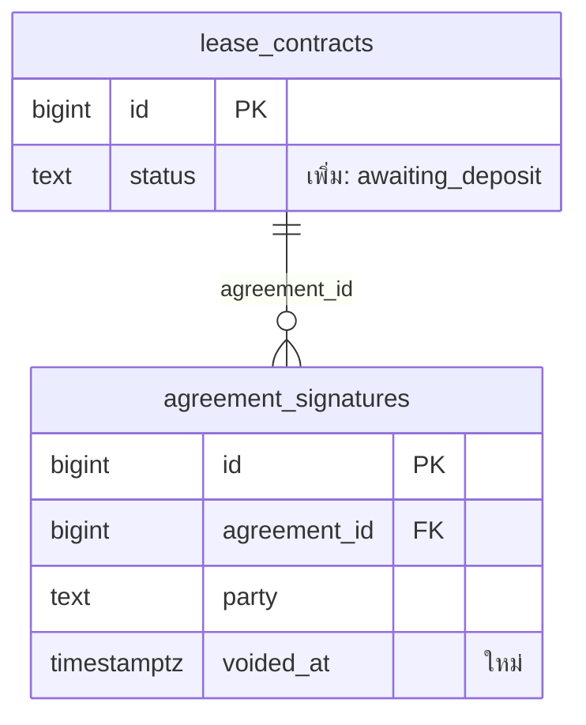

# supabase/AGENTS.md — ฐานข้อมูล, migration และ entity

ใช้เพิ่มจาก `AGENTS.md` ที่ root ทุกข้อในไฟล์ root ยังใช้อยู่
ใช้เมื่อแตะ `supabase/` หรือ `apps/api/src/entities/` และกฎฉบับเต็มอยู่ที่ `supabase/MIGRATION-RULES.md`

## 1. ทำไมต้องระวังเป็นพิเศษ

- push เข้า `develop` แล้ว migration จะรันบน Supabase dev ทันที
- rollback บน Railway ย้อนโค้ดได้ แต่ไม่ได้ย้อนฐานข้อมูล
- ข้อมูลที่ migration แปลงหรือลบไปแล้วเอาคืนไม่ได้

## 2. กฎสั้น (รายละเอียดอยู่ใน `MIGRATION-RULES.md`)

1. แก้ entity ต้องมีไฟล์ migration ใน `supabase/migrations` อยู่ใน commit เดียวกัน และชื่อ constraint กับ index ใน entity ต้องตรงกับไฟล์ SQL
2. ตั้งชื่อไฟล์ด้วยเวลาปัจจุบัน ก่อน merge ให้ตรวจว่าไม่มีไฟล์ที่พึ่งไฟล์อื่นแต่ชื่อเรียงมาก่อน
3. ตารางใหม่ต้องเปิด RLS ในไฟล์ของตัวเอง: `ALTER TABLE public.<ตาราง> ENABLE ROW LEVEL SECURITY;`
4. เขียน `public.` นำหน้าชื่อตารางทุกครั้ง
5. ทุกไฟล์รันใน transaction เดียว จึงห้ามใช้ `CREATE INDEX CONCURRENTLY`
6. **ห้ามลบหรือเปลี่ยนชื่อคอลัมน์พร้อมกับขึ้นโค้ดใหม่** ให้ทำ 2 รอบ คือรอบแรกเพิ่มของใหม่และย้ายข้อมูล แล้วค่อยลบของเดิมหลังจากรอบแรกใช้งานได้อย่างน้อย 1 รอบ deploy
7. ห้ามใส่ seed สำหรับ demo หรือ dev ลงในฐานข้อมูล prod
8. ห้ามรันอะไรกับฐานข้อมูลของทีมเอง ให้เตรียมคำสั่งไว้ แล้วให้ผู้ใช้เป็นคนรัน

## 3. ชุดวิเคราะห์ผลกระทบ (ต้องส่งก่อนแก้ แล้วรออนุมัติ)

ใช้เมื่อเพิ่ม ลบ หรือแก้ตาราง, คอลัมน์, FK, index, constraint, enum/สถานะ, RLS, trigger หรือ view

1. **สิ่งที่เปลี่ยน:** ตาราง คอลัมน์ ชนิดข้อมูล ค่าว่างได้ไหม ค่าเริ่มต้น FK index constraint และ RLS
2. **ERD ก่อนและหลังแก้:** วาดเฉพาะตารางที่เปลี่ยนกับตารางที่ต่ออยู่โดยตรง ห้ามวาดทั้งระบบ ใช้ Mermaid ตามแม่แบบในข้อ 4 และต้องอ่านจาก entity กับ migration จริง ห้ามวาดจากความจำ
3. **flow ก่อนและหลังแก้:** ใครเขียนข้อมูลลงตาราง (API ตัวไหน) ใครอ่าน (API ตัวไหน หน้าจอไหน) และสถานะเปลี่ยนอย่างไร ให้อ้างชื่อไฟล์กับเลขบรรทัด
4. **ผลกระทบ:** entity, service, controller, ชนิดข้อมูลใน `packages/types`, หน้าจอในแอปและเว็บ, เทสที่ต้องแก้ และ `check:roles` ถ้าแตะ role
5. **ข้อมูลเดิม:** ตอนนี้มีข้อมูลกี่แถว (ให้เตรียม SQL แบบอ่านอย่างเดียวให้ผู้ใช้รันนับเอง) migration จะแปลงข้อมูลเดิมอย่างไร และแถวที่ไม่ตรงเงื่อนไขใหม่จะเกิดอะไรขึ้น
6. **ถ้าต้องถอยกลับ:** ทำอย่างไร และข้อมูลส่วนไหนเอาคืนไม่ได้
7. **ลำดับการขึ้นระบบ:** ทำรอบเดียวได้ หรือต้องแบ่ง 2 รอบตามกฎข้อ 6

## 4. แม่แบบ ERD



- เขียน 2 ชุด: "ก่อนแก้" และ "หลังแก้"
- ใส่คำว่า "ใหม่", "ลบ" หรือ "เปลี่ยน: ..." ไว้ท้ายคอลัมน์ที่เปลี่ยน
- แสดงเฉพาะคอลัมน์ที่เกี่ยวกับงาน คอลัมน์อื่นละไว้

## 5. ก่อนส่งงาน

```bash
cd apps/api
npm run db:push -- --check     # กับฐานข้อมูลในเครื่องเท่านั้น
npm run db:check -- --check    # entity ต้องตรงกับ migration: ต้องขึ้น ✓
```

และต้องให้อีกคนตรวจ ERD กับ entity จริงก่อน merge เพราะ AI วาด ERD ผิดได้
